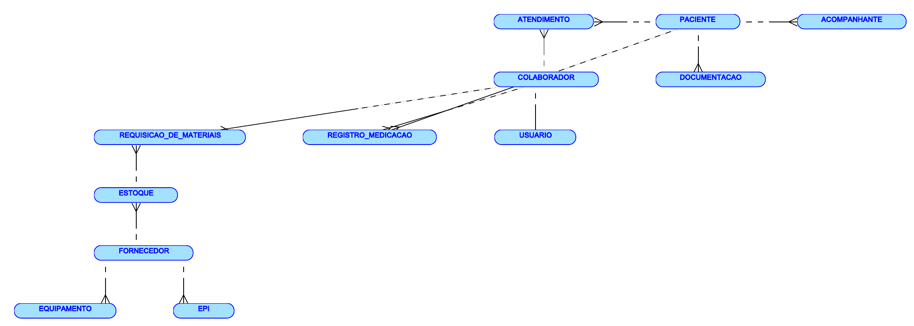

# Sistema de Gestão de um Hospital Infantil

**Projeto acadêmico de modelagem e implementação de banco de dados** para um sistema interno de gestão hospitalar, com foco em pacientes pediátricos, atendimentos, colaboradores, administração de medicamentos e recursos hospitalares.

> **Situação do projeto:** modelagem conceitual, lógica e física documentada; scripts de demonstração em MySQL preparados; **aplicação web, autenticação e operação hospitalar não implementadas**. Não utilizar com dados reais ou em atendimento clínico.

**Disciplina:** Modelagem de Banco de Dados (Avaliação A2)

**Professor:** Rubem Matimoto Koide

**Data de referência:** 11/11/2026

## Equipe

- Pietro Ferreira dos Santos
- Erick De Melo Kujavski
- Sarah Firmino
- Pedro Hiel Carrano
- Thiago Santos

## Objetivo

Centralizar o cadastro de pacientes, acompanhantes, documentos e colaboradores; relacionar atendimentos e registros de medicação a responsáveis identificáveis; registrar fornecedores, estoque, EPIs, equipamentos e requisições; e propor separação de acesso conforme a função do colaborador.

## Modelagem de dados

O modelo contém **12 entidades** e relacionamentos com chaves primárias e estrangeiras. Os diagramas foram elaborados no **Oracle SQL Developer Data Modeler**; a versão SQL fornecida neste repositório é uma **adaptação para MySQL 8.0+**.



Visualização completa:

| Modelo | Imagem | PDF original |
| --- | --- | --- |
| Conceitual | [Abrir PNG](docs/diagramas/modelo-conceitual.png) | [Abrir PDF](docs/diagramas/modelo-conceitual.pdf) |
| Lógico | [Abrir PNG](docs/diagramas/modelo-logico.png) | [Abrir PDF](docs/diagramas/modelo-logico.pdf) |
| Físico | [Abrir PNG](docs/diagramas/modelo-fisico.png) | [Abrir PDF](docs/diagramas/modelo-fisico.pdf) |

### Entidades

| Área | Entidades |
| --- | --- |
| Assistencial | `paciente`, `acompanhante`, `documentacao`, `atendimento`, `registro_medicacao` |
| Equipe e acesso | `colaborador`, `usuario` |
| Suprimentos | `fornecedor`, `estoque`, `requisicao_de_materiais`, `epi`, `equipamento` |

Um paciente pode possuir vários atendimentos e documentos. Cada atendimento e cada registro de medicação se referem a um paciente e a um colaborador responsável. Cada item em estoque está associado a um fornecedor, e cada requisição se refere a um item. A conta de usuário é vinculada a um colaborador, com limite de uma conta por colaborador na versão SQL.

## Organização do repositório

```text
.
├── .github/workflows/validar-mysql.yml       # Verificação automática quando o GitHub Actions executar
├── database/
│   ├── 01_estrutura_mysql.sql               # DDL: banco e 12 tabelas
│   ├── 02_dados_ficticios.sql               # DML: 10 registros por tabela
│   ├── 03_consultas_relatorios.sql          # DQL: consultas e relatórios
│   └── 04_demonstracao_ddl_dml_dql_dcl_tcl.sql
├── tests/validar_mysql.sh                  # Verificações de contagem e integridade
├── docs/
│   ├── apresentacao/                       # PPTX e PDF para defesa
│   ├── relatorio/                          # DOCX e PDF do relatório acadêmico
│   ├── diagramas/                          # Modelos em PDF e PNG
│   ├── fontes/                             # Relatório original da equipe
│   ├── evidencias/                         # Orientações para capturas reais
│   ├── guia-de-defesa.txt
│   ├── pre-validacao-sqlite.txt
│   └── notas-de-implementacao.md
├── .editorconfig
├── .gitattributes
├── .gitignore
├── CONTRIBUTING.md
└── README.md
```

## Executar o banco de dados (MySQL)

**Pré-requisitos:** MySQL Server **8.0+** e MySQL Workbench (ou cliente `mysql`), com permissão para criar o banco `hospital_infantil`.

No **MySQL Workbench**, abra e execute **na ordem**, em ambiente de testes:

1. [`database/01_estrutura_mysql.sql`](database/01_estrutura_mysql.sql) — cria o banco e as 12 tabelas com seus vínculos.
2. [`database/02_dados_ficticios.sql`](database/02_dados_ficticios.sql) — insere **10 linhas de dados fictícios por tabela**. **Execute uma única vez** em banco vazio.
3. [`database/03_consultas_relatorios.sql`](database/03_consultas_relatorios.sql) — consultas de atendimentos, medicamentos, requisições, vencimentos e contagens.
4. [`database/04_demonstracao_ddl_dml_dql_dcl_tcl.sql`](database/04_demonstracao_ddl_dml_dql_dcl_tcl.sql) — exemplos de DDL, DML, DQL, DCL e TCL, **apenas em ambiente de teste**; o trecho de DCL exige privilégios apropriados.

Alternativamente, em terminal com o cliente configurado (as três primeiras etapas):

```bash
mysql -u root -p < database/01_estrutura_mysql.sql
mysql -u root -p < database/02_dados_ficticios.sql
mysql -u root -p < database/03_consultas_relatorios.sql
```

> **Atenção:** os comandos **não são um processo de migração para bases existentes**. A carga de 10 registros inclui IDs explícitos e pode gerar erro de chave duplicada ao ser executada novamente. Use uma instância/banco de testes separado.

### Testes e evidências

Após preparar o banco, execute os testes opcionais a partir do Git Bash. Configure previamente a autenticação do cliente MySQL (por exemplo, arquivo `~/.my.cnf` protegido ou um login configurado); o script não solicita senha interativamente:

```bash
MYSQL_USER=root bash tests/validar_mysql.sh
```

Os testes verificam a presença das 12 tabelas, 12 referências de chave estrangeira e 10 registros em cada tabela. Também realizam um teste negativo de integridade. O fluxo de **GitHub Actions**, quando ativado e executado, fará a validação em um serviço MySQL descartável e exibirá os resultados nos logs.

Para a entrega acadêmica, as **evidências devem ser capturas reais** do Workbench ou de uma execução verificável. Instruções em [`docs/evidencias/README.md`](docs/evidencias/README.md).

## Apresentação e relatório

- [Apresentação da defesa — PowerPoint](docs/apresentacao/apresentacao-hospital-infantil.pptx)
- [Apresentação da defesa — PDF](docs/apresentacao/apresentacao-hospital-infantil.pdf)
- [Relatório acadêmico — PDF](docs/relatorio/relatorio-hospital-infantil-abnt.pdf)
- [Relatório acadêmico editável — DOCX](docs/relatorio/relatorio-hospital-infantil-abnt.docx)
- [Relatório original usado como fonte](docs/fontes/relatorio-original-equipe.pdf)

## LGPD, segurança e uso de IA

O domínio é sensível porque os registros podem incluir **dados pessoais de saúde de crianças e adolescentes**. A aplicação em produção precisaria observar a **Lei Geral de Proteção de Dados Pessoais (Lei nº 13.709/2018)**, incluindo os princípios de finalidade, necessidade, segurança e melhor interesse do público infantojuvenil, com avaliação das bases legais aplicáveis.

As seguintes medidas são **requisitos propostos, não funcionalidades prontas**: autenticação segura, senhas com hash robusto, autorização verificada no servidor, HTTPS, auditoria, minimização de dados, cópias de segurança e política de retenção. Os exemplos disponibilizados usam somente **dados sintéticos/fictícios**, incluindo CPFs/CNPJs não válidos e hashes não autenticáveis.

O projeto **não incorpora recursos de inteligência artificial**. Na documentação de referência datada de 11/11/2026, o **PL nº 2.338/2023** é analisado como proposta legislativa, não como uma lei geral já vigente. A situação normativa deve ser conferida novamente antes de uma nova apresentação ou implantação.

Consulte as [notas de implementação e limitações](docs/notas-de-implementacao.md).

## Limitações e estágio de validação

- A modelagem física recebida usa tipos Oracle (`NUMBER`, `VARCHAR2`, `CLOB`); os arquivos `.sql` foram adaptados para MySQL.
- A pré-validação auxiliar anterior foi feita em **SQLite**, não equivale à execução em MySQL.
- **Não havia servidor MySQL disponível na preparação inicial**, portanto este repositório não contém capturas reais de MySQL já executado.
- Não há frontend/backend implementado nem controle de acesso clínico efetivo.
- Os vínculos de medicação/estoque, movimentação de saldos e histórico de auditoria ainda dependem de implementação específica.
- A existência do fluxo de GitHub Actions **não significa que ele já executou com êxito**.

## Publicação no GitHub

Crie um repositório vazio e envie **o conteúdo desta pasta**, não o arquivo `.zip` sem extrair. Passo a passo em [PUBLICAR_NO_GITHUB.md](PUBLICAR_NO_GITHUB.md).

## Licenciamento

Nenhuma licença aberta foi definida pela equipe. Antes de adotar uma licença de código aberto ou permitir reutilização por terceiros, alinhe a decisão com todos os autores.
